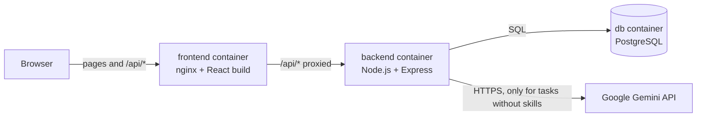
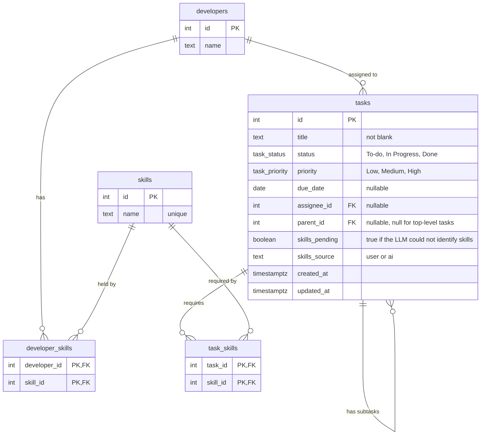

# Task Assignment

A small full-stack app for creating tasks, breaking them down into subtasks, and handing them
to developers who actually have the skills for them. If you create a task without picking any
skills, the backend asks Google Gemini to work them out from the title.

I started by working through every deliverable and the frameworks involved, and built the base
requirements first. After that I went back and worked on the user experience, so the finished
app looks quite different from the wireframes, with a few features I think a task assignment
app needs. The part I enjoyed most was the LLM work. It was my first time building with one,
and it's a skill I can already see myself using in other projects.

- **Frontend:** TypeScript, React, Vite, TanStack Query, Tailwind CSS
- **Backend:** TypeScript, Node.js, Express
- **Database:** PostgreSQL
- **LLM:** Google Gemini API
- **Runs with:** Docker Compose

## Contents

- [Quick start](#quick-start)
- [Configuration](#configuration)
- [Using the app](#using-the-app)
- [System design](#system-design)
- [Database design](#database-design)
- [API](#api)
- [Business rules](#business-rules)
- [How the LLM part works](#how-the-llm-part-works)
- [Testing](#testing)
- [Running it without Docker](#running-it-without-docker)
- [Libraries I used and why](#libraries-i-used-and-why)
- [Assumptions](#assumptions)
- [Requirements coverage](#requirements-coverage)
- [Extras beyond the brief](#extras-beyond-the-brief)
- [What I'd do next](#what-id-do-next)
- [Project structure](#project-structure)

## Quick start

You'll need [Docker Desktop](https://www.docker.com/products/docker-desktop/), or Docker Engine
with the Compose plugin v2.24 or newer (`docker compose version` shows it).

1. Add the Gemini API key (I've sent it by email):

   ```bash
   cp backend/.env.example backend/.env
   ```

   Then open `backend/.env` and paste the key after `GEMINI_API_KEY=`.

2. Build and start everything:

   ```bash
   docker compose up --build
   ```

3. Open **http://localhost:8080**

The database is created, migrated and seeded automatically on first start. Data is kept in a
Docker volume, so it survives restarts.

To stop: `docker compose down`. To stop and delete all data: `docker compose down -v`.

> **No API key?** The app still runs. Tasks created without skills are saved with their skills
> marked as "Not identified" and cannot be assigned until skills are identified. Once a key is
> added (and the backend restarted with `docker compose up -d`), use the **Retry** link on the
> task list.

## Configuration

| Variable | Where | Purpose | Default |
|---|---|---|---|
| `GEMINI_API_KEY` | `backend/.env` | Gemini API key. Free keys: https://aistudio.google.com/apikey | none |
| `GEMINI_MODEL` | `backend/.env` | Gemini model used for skill identification | `gemini-3.5-flash-lite` |
| `APP_PORT` | shell or root `.env` | Port the app is served on | `8080` |
| `DATABASE_URL` | `backend/.env` | Only used when running the backend outside Docker | `localhost:5432` |

Inside Docker, `DATABASE_URL` and `PORT` are set by `docker-compose.yml` and override
`backend/.env`. `.env` files are ignored by Git, so keys never reach the repository.

## Using the app

- **Tasks** (`/`) shows each task as a card, with its subtasks nested inside. On each card:
  - **Priority pill** (High, Medium, Low), colour-coded with a flag icon. Click it to change it.
  - **Skills.** Skills chosen by Gemini have a ✨ sparkle.
  - **Due date pill.** Click it to pick a date. It turns amber when due within 2 days, red when
    overdue, and grey once the task is Done.
  - **Status dropdown.** Changing the status of an unassigned task shows a popup asking you to
    assign it first.
  - **Assignee avatar** with the developer's initials. Hover over it to see their full name and
    skills; click it to pick from the developers who have **every** skill the task requires.
  - **Progress bar** on tasks with subtasks, counting Done subtasks at every level.
  - **⋯ menu** to edit (title, skills, priority, due date) or delete the task. Deleting asks for
    confirmation and also deletes its subtasks.
- **Search and quick filters** above the list: search titles, and toggle status, priority,
  Unassigned, Overdue and Due soon. A parent stays visible (faded) when only its subtasks match.
- **Create Task** (`/tasks/new`) has a form for a task, including priority and due date.
  **+ Add subtask under 1** adds a nested subtask form below it, which can have subtasks of its
  own (numbered 1.1, 1.1.1, ...). Leave the skill checkboxes empty to let the LLM pick the
  skills. The Save button says how many tasks it will save, and the whole tree is saved together.

The seed data adds the developers and skills from the requirements, plus the three example tasks
from the wireframe so the list is not empty on first start.

| Developer | Skills |
|---|---|
| Alice | Frontend |
| Bob | Backend |
| Carol | Frontend, Backend |
| Dave | Backend |

## System design



There are three containers:

- **frontend:** nginx serves the built React app and passes anything under `/api/` on to the
  backend. Since the browser only ever talks to one address, I didn't need to set up CORS.
- **backend:** the Express API. Every time it starts, it runs the database migrations and the
  seed (both are safe to repeat) before it starts taking requests.
- **db:** PostgreSQL 17, with a named volume for the data.

They start in order using health checks: the API waits until the database accepts connections,
and nginx waits until the API's `/health` endpoint answers.

### Backend layers

I kept the backend in a few simple layers so each file has one job:

| Layer | Folder | What it does |
|---|---|---|
| Routes | `backend/src/routes` | HTTP only: read the request, check it with Zod, call a service, send the response |
| Services | `backend/src/services` | The business rules and all the SQL |
| LLM client | `backend/src/llm` | The call to Gemini |
| Error handler | `backend/src/middleware` | Turns every error into the same JSON shape |

I wrote the SQL by hand with parameterised queries (`$1`, `$2`, ...). It keeps the queries easy
to read and protects against SQL injection.

### Frontend structure

| File | What it does |
|---|---|
| `src/api.ts` | Every call to the backend, plus the shared types |
| `src/pages/TaskListPage.tsx` | The task list: filters, cards, and the edit/delete/message popups |
| `src/pages/CreateTaskPage.tsx` | The create form |
| `src/components/TaskCard.tsx` | One task card, which draws itself again for each subtask |
| `src/components/TaskFormNode.tsx` | One task's form fields, which draws itself again for each subtask |
| `src/components/AssigneePicker.tsx`, `Avatar.tsx` | Avatar button, hover card and developer menu |
| `src/components/PriorityPicker.tsx`, `DuePill.tsx`, `ProgressBar.tsx`, `SkillChips.tsx` | The pills and progress bar on a card |
| `src/components/FilterBar.tsx` | Search box and filter toggles |
| `src/components/Modal.tsx` and the dialogs | Popups, built on the browser's own `<dialog>` |
| `src/lib/taskFilters.ts`, `src/lib/dates.ts` | Filtering, progress and due-date logic, kept as plain functions so they're easy to test |
| `src/taskDraft.ts` | The unsaved form tree and turning it into what the API expects |

TanStack Query loads the data and keeps it fresh. After any change the task list is fetched
again, so the screen always shows what the server actually saved.

## Database design



The main decisions:

- **Skills get their own table**, linked to developers and tasks through join tables, since a
  skill belongs to many developers and many tasks (many-to-many).
- **A task has at most one assignee**, so `assignee_id` is just a nullable column on `tasks`.
- **A subtask is a task row with a `parent_id`.** That way it gets every property of a task for
  free and can nest as deep as needed. Whole trees are read with a recursive query
  (`WITH RECURSIVE`).
- **Status is a PostgreSQL enum**, so the database itself refuses anything that isn't a real
  status.
- **Migrations are versioned SQL files** in `backend/migrations`. Whenever a part of the brief
  changed the schema, I added a new migration instead of editing an old one, so the history
  shows how the design grew: `0001_create_core_tables`, `0002_add_subtasks`,
  `0003_add_skills_pending`, and `0004_add_priority_due_date_skills_source` for the extras.
- **Due dates are a `DATE`**, not a timestamp, and travel as text like `"2026-11-05"`. A
  deadline is a day, not a moment, and this way it can't shift by a day because of time zones.

## API

Base URL: `/api` (through nginx at http://localhost:8080/api). Everything is JSON.

| Method | Path | What it does |
|---|---|---|
| `GET` | `/api/tasks` | All top-level tasks, each with its subtasks nested inside |
| `GET` | `/api/tasks/:id` | One task (at any level) with the subtasks below it |
| `POST` | `/api/tasks` | Create a task, optionally with nested subtasks |
| `PATCH` | `/api/tasks/:id` | Change a task's status, assignee, title, skills, priority or due date |
| `DELETE` | `/api/tasks/:id` | Delete a task and all its subtasks (`204 No Content`) |
| `POST` | `/api/tasks/:id/identify-skills` | Ask Gemini again for a task whose skills are pending |
| `GET` | `/api/developers` | All developers with their skills and assigned tasks |
| `GET` | `/api/developers/:id` | One developer |
| `GET` | `/api/skills` | All skills with the developers who have them |
| `GET` | `/api/skills/:id` | One skill |
| `GET` | `/health` | Backend health check (used by Docker, not exposed through nginx) |

### Create a task

`POST /api/tasks`

```json
{
  "title": "Build the profile feature",
  "skillIds": [1, 2],
  "priority": "High",
  "dueDate": "2026-11-20",
  "subtasks": [
    { "title": "Build the profile page", "skillIds": [1] },
    { "title": "Add the profile API", "subtasks": [] }
  ]
}
```

- `title` is required (1-1000 characters, after trimming spaces).
- `skillIds` is optional. Leave it empty or out and Gemini picks the skills.
- `priority` is optional: `Low`, `Medium` (default) or `High`.
- `dueDate` is optional: a date as `YYYY-MM-DD`, or `null`.
- `subtasks` is optional and has the same shape, up to 10 levels deep and 100 tasks in total.
- New tasks always start as `To-do` and unassigned.
- The whole tree saves in one transaction, so if anything in it is invalid, nothing is saved.

Response `201`: the new task, in the same shape as `GET /api/tasks/:id`.

### Task format

```json
{
  "id": 1,
  "title": "Build the profile feature",
  "status": "To-do",
  "priority": "High",
  "dueDate": "2026-11-20",
  "parentId": null,
  "skillsPending": false,
  "skillsSource": "user",
  "skills": [{ "id": 2, "name": "Backend" }, { "id": 1, "name": "Frontend" }],
  "assignee": null,
  "createdAt": "2026-11-02T08:00:00.000Z",
  "updatedAt": "2026-11-02T08:00:00.000Z",
  "subtasks": []
}
```

### Update a task

`PATCH /api/tasks/:id`

```json
{ "status": "Done", "assigneeId": 3 }
```

- Send any of `status`, `assigneeId`, `title`, `skillIds`, `priority` and `dueDate`. Anything
  you leave out stays as it is.
- `"assigneeId": null` unassigns the task, and `"dueDate": null` clears the due date.
- `skillIds` replaces the task's skills and needs at least one. Skills set this way count as
  picked by the user (`skillsSource: "user"`). If the current assignee doesn't have the new
  skills, the change is refused.

### Errors

Every error comes back in the same shape:

```json
{ "error": { "code": "DEVELOPER_MISSING_SKILLS", "message": "This developer is missing the required skill(s): Backend" } }
```

Validation errors also include `details`, a list of `{ field, message }`.

| Status | Codes | When |
|---|---|---|
| 400 | `VALIDATION_ERROR`, `BAD_REQUEST`, `UNKNOWN_SKILL`, `UNKNOWN_DEVELOPER` | The input is wrong |
| 404 | `TASK_NOT_FOUND`, `DEVELOPER_NOT_FOUND`, `SKILL_NOT_FOUND`, `NOT_FOUND` | The record or route doesn't exist |
| 422 | `DEVELOPER_MISSING_SKILLS`, `SKILLS_NOT_IDENTIFIED`, `TASK_NOT_ASSIGNED`, `SUBTASKS_NOT_DONE`, `PARENT_TASK_DONE` | The request is fine but a business rule says no |
| 502 | `SKILL_IDENTIFICATION_FAILED` | Retrying Gemini failed again |
| 500 | `INTERNAL_ERROR` | Something unexpected (details only go to the server log) |

## Business rules

The backend enforces every rule. The frontend helps too (for example by only listing developers
who qualify), but I never rely on it, since anyone can call the API directly.

1. **A task can only go to a developer who has every skill it needs.** A Frontend + Backend task
   can only go to Carol.
2. **A task can only be Done once all its subtasks are Done.**
3. **A subtask can't be reopened while its parent is Done.** You reopen the parent first.
   Together with rule 2, this keeps one simple promise: a Done task only ever has Done subtasks,
   so checking a task's direct subtasks is always enough.
4. **A task whose skills couldn't be identified can't be assigned.** With no skills, it would
   match every developer.
5. **A task's status can only change once someone is assigned.** Work should belong to someone
   before it moves. Assigning and changing status in the same request is fine.

### Two requests at the same time

Rules 2 and 3 involve two rows (a task and its parent or subtasks). If two requests landed at
the same moment, each could pass its check and together they'd break the rule. To stop that,
updates run in a transaction and lock the rows they read (`SELECT ... FOR UPDATE` /
`FOR SHARE`). Every request locks the parent before the child, so two requests can never end up
waiting on each other forever (a deadlock).

There's a test that fires both requests at once, 40 times over. When I took the locks out, it
failed, which is how I know it's actually testing something.

This was the part I had to think hardest about. It's easy to overlook, but it becomes a real
problem as soon as several people use the app at once. Locking the rows in a fixed order
(parent first, then child) turned out to be a small change that closes the gap completely.

## How the LLM part works

When a task or subtask is created without skills, the backend asks Gemini to pick them from the
title. The user doesn't have to press anything.

- **One call per task tree.** All the titles that need skills go in one request, so a task with
  lots of subtasks still costs one API call.
- **Answers are restricted.** Gemini has to reply in a fixed JSON shape where the skill values
  can only be skills from the database. I then check the answer again with Zod (one result per
  title, at least one real skill each) before using it.
- **The prompt** explains what each skill covers, includes the three examples from the brief,
  and tells the model to treat titles as data and ignore any instructions inside them.
- **Outside the transaction.** The Gemini call happens before the database transaction opens,
  so a slow reply never ties up a database connection.
- **When it fails.** Each call times out after 10 seconds and gets one retry. If it still fails,
  the task is saved anyway with `skillsPending: true`, because losing what the user typed felt
  worse than missing skills. Assignment is blocked until the **Retry** link on the task works.

To check the three examples from the brief against the real API:

```bash
cd backend
npm run llm:check
```

## Testing

| Suite | Command | What it covers |
|---|---|---|
| Backend (71 tests) | `cd backend && npm test` | Every endpoint against a real PostgreSQL database, all business rules, editing and deleting, simultaneous updates, LLM answer validation, and LLM failure handling |
| Frontend (28 tests) | `cd frontend && npm test` | The recursive subtask form; the task list's popup, assignee menu, priority, progress, AI marker, filters, edit and delete; and the filter, progress and due-date logic |

The LLM is replaced with a fake in automated tests so they are fast and free. Backend tests need
PostgreSQL on `localhost:5432` (see below); they create and use a separate
`task_assignment_test` database because they delete tasks between tests.

## Running it without Docker

Needs Node.js 22 or newer.

```bash
# 1. Start just the database, open on localhost:5432
docker compose -f docker-compose.yml -f docker-compose.dev.yml up -d db

# 2. Backend on http://localhost:3000
cd backend
cp .env.example .env        # then add GEMINI_API_KEY
npm ci
npm run migrate
npm run seed
npm run dev

# 3. Frontend on http://localhost:5173 (in a second terminal)
cd frontend
npm ci
npm run dev
```

In development, Vite forwards `/api` to the backend on port 3000.

## Libraries and why they were chosen

### Backend

| Library | Why |
|---|---|
| `express` | The most widely used Node.js web framework; small and well understood. Version 5 forwards errors from async route handlers automatically. |
| `zod` | Validates request bodies and LLM answers at runtime. TypeScript types only exist at compile time, so untrusted input needs a runtime check. Its schemas also produce the TypeScript types. |
| `pg` | The standard PostgreSQL driver. Queries are written in plain SQL, which keeps them readable and makes the recursive query and row locks straightforward. No ORM was needed. |
| `node-pg-migrate` | Runs the versioned SQL migration files and records which ones have been applied. |
| `dotenv` | Loads `backend/.env` when running outside Docker. |
| `typescript`, `tsx` | Type checking and compiling; `tsx` runs TypeScript directly during development. |
| `vitest`, `supertest` | Test runner, and sending real HTTP requests to the app in tests. |

Gemini is called with the built-in `fetch` rather than an SDK, since only one endpoint is used.

### Frontend

| Library | Why |
|---|---|
| `react`, `react-dom` | Required by the brief. |
| `vite`, `@vitejs/plugin-react` | Fast development server and production build for React and TypeScript. |
| `react-router-dom` | Client-side routing between the two pages of the single-page app. |
| `@tanstack/react-query` | Handles loading, error and refresh states for server data, which would otherwise need hand-written state in every page. |
| `tailwindcss`, `@tailwindcss/vite` | Styling with utility classes in the markup, with no separate CSS files to maintain. |
| `lucide-react` | Small, consistent icons (flags, calendar, sparkle, menu). Each icon is its own component, so only the icons used end up in the build. |
| `vitest`, `jsdom`, `@testing-library/*` | Component tests that use the form the way a user would. |
| `oxlint` | Linting, included by the Vite template. |

## Assumptions

The brief allows assumptions where details are not specified. These were made:

- **Statuses** are `To-do`, `In Progress` and `Done` ("etc." in the brief).
- **A task has at most one assignee** and can be unassigned.
- **"Has the required skills" means all of them**, not any one.
- **Subtasks have their own skills and assignee**, independent of their parent ("same properties
  as a Task").
- **Subtasks are created together with their parent** on the creation page, as the brief
  describes. There is no endpoint to add a subtask to an existing task later.
- **New tasks start as To-do and unassigned.**
- **Status changes need an assignee.** This is a deliberate extra rule (see Business rules).
  The brief's requirement that status can be changed still holds once a task is assigned.
- **A Done task's subtasks cannot be reopened** until the parent is reopened (see Business rules).
- **Nesting is limited** to 10 levels and 100 tasks per request, to protect the server from
  very large requests.
- **Editing** covers the title, skills, priority and due date. Skills cannot be emptied while
  editing; leaving them empty for the LLM to fill in is only offered when creating a task.
- **Deleting a task deletes its subtasks too.**
- **Subtasks cannot be moved** to another parent after creation.
- **Avatars show initials**, since developers have no profile pictures in the data.
- **The three wireframe tasks are seeded as demo data** in addition to the required developers
  and skills, with sample priorities and due dates set relative to the day the seed runs.
- **No authentication**, since the brief does not mention users or login.

## Requirements coverage

| Requirement | Where |
|---|---|
| 1.1 PostgreSQL schema for developers, tasks, skills | `backend/migrations/0001_create_core_tables.sql` |
| 1.2 Seed developers and skills | `backend/db/seed.sql` |
| 2.1 Create, read and update tasks; read developers and skills | `backend/src/routes`, `backend/src/services` |
| 2.1 Assign only to developers with the required skills | `assertDeveloperCanTakeTask` in `taskService.ts` |
| 3.1 Task list page with status and assignee updates | `frontend/src/pages/TaskListPage.tsx` |
| 3.1 Task creation page with skills, no assignee needed | `frontend/src/pages/CreateTaskPage.tsx` |
| 4.1 Subtasks with the same properties as tasks | `backend/migrations/0002_add_subtasks.sql` |
| 4.2 Done only when all subtasks are Done | `assertStatusChangeAllowed` in `taskService.ts` |
| 4.3 Nested subtasks created with dynamic React components | `frontend/src/components/TaskFormNode.tsx` |
| 5.1-5.3 LLM identifies missing skills automatically on the backend | `backend/src/services/skillIdentification.ts`, `backend/src/llm/gemini.ts` |
| 6.1-6.2 Containerised and run with docker-compose | `docker-compose.yml`, `backend/Dockerfile`, `frontend/Dockerfile` |
| 7.1 Public repository with README | This file |

## Extras beyond the brief

The Git tag [`v1-requirement`](../../tree/v1-requirement) marks the version that does
exactly what the brief asks. Once that was done, I added these on top, with every original
requirement still working. The tag [`v2-enhancement`](../../tree/v2-enhancement) marks this
version:

- Task cards with a pastel theme, instead of the table
- Edit and delete from a ⋯ menu on each card
- Priority (High, Medium, Low) with colour-coded flag pills
- Due dates with a calendar pill that changes colour as the deadline gets close
- Assignee avatars with a hover card showing name and skills
- Progress bars on tasks with subtasks
- A ✨ on skills that Gemini picked
- Search and quick filters

I added these after putting myself in a user's shoes and asking how this app would fit into my
own workflow. Each one is something that would help me keep my tasks organised day to day.

## What I'd do next

- Let subtasks be added to an existing task, and moved to a different parent
- Login, so "assigned to me" and an activity history become possible
- A way for admins to manage developers and skills from the app

## Project structure

```
.
├── docker-compose.yml          # db, backend and frontend
├── docker-compose.dev.yml      # opens the database for local development
├── backend
│   ├── Dockerfile
│   ├── migrations/             # versioned SQL schema changes
│   ├── db/seed.sql             # seed data
│   ├── src
│   │   ├── app.ts              # Express app and routes
│   │   ├── index.ts            # starts the server
│   │   ├── validation.ts       # Zod schemas for requests
│   │   ├── errors.ts
│   │   ├── db/                 # connection pool, transactions, seed runner
│   │   ├── llm/                # Gemini client and example check
│   │   ├── middleware/         # error handler
│   │   ├── routes/             # HTTP layer
│   │   └── services/           # business rules and SQL
│   └── tests/
└── frontend
    ├── Dockerfile
    ├── nginx.conf
    └── src
        ├── api.ts              # every call to the backend
        ├── App.tsx             # header and page routes
        ├── components/         # cards, form, pickers, popups
        ├── lib/                # filters, dates, styles
        ├── pages/              # TaskListPage, CreateTaskPage
        └── taskDraft.ts
```

