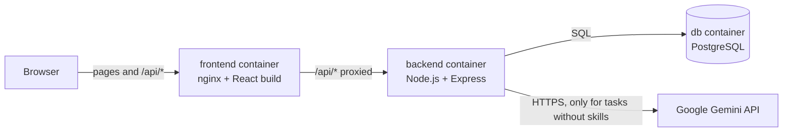
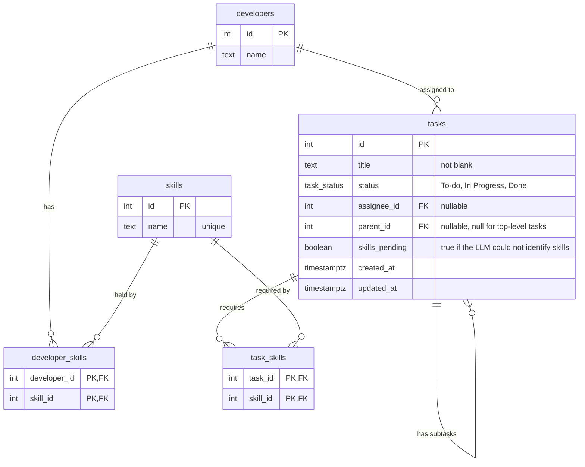

# Task Assignment

A small full-stack app for creating tasks, breaking them down into subtasks, and handing them
to developers who actually have the skills for them. If you create a task without picking any
skills, the backend asks Google Gemini to work them out from the title.

I started by working through every deliverable and the frameworks involved, and built the base
requirements first. The part I enjoyed most was the LLM work. It was my first time building with one,
and it's a skill I can already see myself using in other projects.

- **Frontend:** TypeScript, React, Vite, TanStack Query, Tailwind CSS
- **Backend:** TypeScript, Node.js, Express
- **Database:** PostgreSQL
- **LLM:** Google Gemini API
- **Runs with:** Docker Compose

## Contents

- [Quick start](#quick-start)
- [Configuration](#configuration)
- [Using the app](#using-the-app)
- [System design](#system-design)
- [Database design](#database-design)
- [API](#api)
- [Business rules](#business-rules)
- [LLM skill identification](#llm-skill-identification)
- [Testing](#testing)
- [Local development without Docker](#local-development-without-docker)
- [Libraries and why they were chosen](#libraries-and-why-they-were-chosen)
- [Assumptions](#assumptions)
- [Requirements coverage](#requirements-coverage)
- [Project structure](#project-structure)

## Quick start

You need [Docker Desktop](https://www.docker.com/products/docker-desktop/), or Docker Engine
with the Compose plugin v2.24 or newer (`docker compose version` shows it).

1. Add your Gemini API key:

   ```bash
   cp backend/.env.example backend/.env
   ```

   Open `backend/.env` and paste the key after `GEMINI_API_KEY=`.

2. Build and start everything:

   ```bash
   docker compose up --build
   ```

3. Open **http://localhost:8080**

The database is created, migrated and seeded automatically on first start. Data is kept in a
Docker volume, so it survives restarts.

To stop: `docker compose down`. To stop and delete all data: `docker compose down -v`.

> **No API key?** The app still runs. Tasks created without skills are saved with their skills
> marked as "Not identified" and cannot be assigned until skills are identified. Once a key is
> added (and the backend restarted with `docker compose up -d`), use the **Retry** link on the
> task list.

## Configuration

| Variable | Where | Purpose | Default |
|---|---|---|---|
| `GEMINI_API_KEY` | `backend/.env` | Gemini API key. Free keys: https://aistudio.google.com/apikey | none |
| `GEMINI_MODEL` | `backend/.env` | Gemini model used for skill identification | `gemini-3.5-flash-lite` |
| `APP_PORT` | shell or root `.env` | Port the app is served on | `8080` |
| `DATABASE_URL` | `backend/.env` | Only used when running the backend outside Docker | `localhost:5432` |

Inside Docker, `DATABASE_URL` and `PORT` are set by `docker-compose.yml` and override
`backend/.env`. `.env` files are ignored by Git, so keys never reach the repository.

## Using the app

- **Tasks** (`/`) lists every task with its skills, status and assignee. Subtasks are indented
  under their parent. Status and assignee are changed straight from the dropdowns. The assignee
  dropdown only offers developers who have **every** skill the task requires.
- **Create Task** (`/tasks/new`) has a form for a task. **Add Subtask** adds a nested subtask
  form, which can have subtasks of its own (numbered 1, 1.1, 1.1.1, ...). Leave the skill
  checkboxes empty to let the LLM pick the skills.

The seed data adds the developers and skills from the requirements, plus the three example tasks
from the wireframe so the list is not empty on first start.

| Developer | Skills |
|---|---|
| Alice | Frontend |
| Bob | Backend |
| Carol | Frontend, Backend |
| Dave | Backend |

## System design



- **frontend:** nginx serves the built React single-page app and forwards `/api/*` to the
  backend. Because the browser only talks to one address, no CORS setup is needed.
- **backend:** an Express API. On start it applies database migrations and runs the seed (both
  are safe to repeat), then serves requests.
- **db:** PostgreSQL 17 with a named volume for its data.

Containers start in order using health checks: the API waits for the database to accept
connections, and nginx waits for the API's `/health` endpoint.

### Backend layers

| Layer | Folder | Responsibility |
|---|---|---|
| Routes | `backend/src/routes` | HTTP only: read the request, validate it with Zod, call a service, send the response |
| Services | `backend/src/services` | Business rules and SQL |
| LLM client | `backend/src/llm` | The call to Gemini |
| Error handler | `backend/src/middleware` | Turns every error into the same JSON format |

SQL is written by hand with parameterised queries (`$1`, `$2`, ...), which keeps the queries
visible and prevents SQL injection.

### Frontend structure

| File | Responsibility |
|---|---|
| `src/api.ts` | Every call to the backend, plus the shared types |
| `src/pages/TaskListPage.tsx` | Task list with status and assignee dropdowns |
| `src/pages/CreateTaskPage.tsx` | Task creation form |
| `src/components/TaskFormNode.tsx` | One task's form fields; renders itself again for each subtask |
| `src/taskDraft.ts` | The unsaved form tree and its conversion to the API format |

Server data is loaded and refreshed with TanStack Query. After a change, the task list is
fetched again, so the page always shows what the server has.

## Database design



- **Skills are a separate table** linked to developers and tasks through join tables, because a
  skill belongs to many developers and many tasks (many-to-many).
- **A task has at most one assignee**, so `assignee_id` is a nullable column on `tasks`.
- **A subtask is a task row with a `parent_id`.** It automatically has every property of a task,
  and nesting can go as deep as needed. Subtask trees are read with a recursive SQL query
  (`WITH RECURSIVE`).
- **Status is a PostgreSQL enum**, so only valid statuses can be stored.
- **Migrations are versioned SQL files** in `backend/migrations`. Each part of the requirements
  that changed the schema added a new migration rather than editing an old one:
  `0001_create_core_tables`, `0002_add_subtasks`, `0003_add_skills_pending`.

## API

Base URL: `/api` (through nginx at http://localhost:8080/api). All bodies are JSON.

| Method | Path | Description |
|---|---|---|
| `GET` | `/api/tasks` | All top-level tasks, each with its subtasks nested inside |
| `GET` | `/api/tasks/:id` | One task (any level) with the subtasks below it |
| `POST` | `/api/tasks` | Create a task, optionally with nested subtasks |
| `PATCH` | `/api/tasks/:id` | Change a task's status and/or assignee |
| `POST` | `/api/tasks/:id/identify-skills` | Retry LLM skill identification for a task whose skills are pending |
| `GET` | `/api/developers` | All developers with their skills and assigned tasks |
| `GET` | `/api/developers/:id` | One developer |
| `GET` | `/api/skills` | All skills with the developers who have them |
| `GET` | `/api/skills/:id` | One skill |
| `GET` | `/health` | Backend health check (used by Docker; not exposed through nginx) |

### Create a task

`POST /api/tasks`

```json
{
  "title": "Build the profile feature",
  "skillIds": [1, 2],
  "subtasks": [
    { "title": "Build the profile page", "skillIds": [1] },
    { "title": "Add the profile API", "subtasks": [] }
  ]
}
```

- `title` is required (1-1000 characters after trimming).
- `skillIds` is optional. If it is empty or missing, the LLM identifies the skills.
- `subtasks` is optional and has the same shape, nested up to 10 levels and 100 tasks in total.
- New tasks are always `To-do` and unassigned.
- The whole tree is saved in one transaction: if anything is invalid, nothing is saved.

Response `201`: the created task, in the same format as `GET /api/tasks/:id`.

### Task format

```json
{
  "id": 1,
  "title": "Build the profile feature",
  "status": "To-do",
  "parentId": null,
  "skillsPending": false,
  "skills": [{ "id": 2, "name": "Backend" }, { "id": 1, "name": "Frontend" }],
  "assignee": null,
  "createdAt": "2026-11-02T08:00:00.000Z",
  "updatedAt": "2026-11-02T08:00:00.000Z",
  "subtasks": []
}
```

### Update a task

`PATCH /api/tasks/:id`

```json
{ "status": "Done", "assigneeId": 3 }
```

- Send `status`, `assigneeId`, or both. Statuses: `To-do`, `In Progress`, `Done`.
- `"assigneeId": null` unassigns the task. Leaving `assigneeId` out keeps the current assignee.

### Errors

Every error has the same format:

```json
{ "error": { "code": "DEVELOPER_MISSING_SKILLS", "message": "This developer is missing the required skill(s): Backend" } }
```

Validation errors also include `details`, a list of `{ field, message }`.

| Status | Codes | When |
|---|---|---|
| 400 | `VALIDATION_ERROR`, `BAD_REQUEST`, `UNKNOWN_SKILL`, `UNKNOWN_DEVELOPER` | Invalid input |
| 404 | `TASK_NOT_FOUND`, `DEVELOPER_NOT_FOUND`, `SKILL_NOT_FOUND`, `NOT_FOUND` | The record or route does not exist |
| 422 | `DEVELOPER_MISSING_SKILLS`, `SKILLS_NOT_IDENTIFIED`, `SUBTASKS_NOT_DONE`, `PARENT_TASK_DONE` | The request is valid but a business rule refuses it |
| 502 | `SKILL_IDENTIFICATION_FAILED` | A retry of LLM skill identification failed |
| 500 | `INTERNAL_ERROR` | Unexpected error (details are logged on the server only) |

## Business rules

All rules are enforced by the backend. The frontend also helps the user (for example by only
listing eligible developers), but the backend never relies on it.

1. **A task can only be assigned to a developer who has every skill it requires.** A task that
   needs Frontend and Backend can only go to Carol.
2. **A task can only be set to Done when all its subtasks are Done.**
3. **A subtask cannot be moved out of Done while its parent is Done.** The parent must be
   reopened first. Together with rule 2, this keeps a simple guarantee: a Done task only ever
   has Done subtasks, so checking a task's direct subtasks is enough.
4. **A task whose skills could not be identified cannot be assigned**, because a task with no
   skills would otherwise match every developer.

### Simultaneous requests

Rules 2 and 3 involve two rows (a task and its parent or subtasks), so two requests arriving at
the same moment could each pass their check and together break the rule. Updates run in a
transaction and lock the rows they read (`SELECT ... FOR UPDATE` / `FOR SHARE`). Every request
locks the parent before the child, so requests cannot wait on each other forever (deadlock).
A test fires both requests at once 40 times; with the locks removed, that test fails.

## LLM skill identification

When a task or subtask is created without skills, the backend asks Gemini to choose them from
the title. The user does not trigger this.

- **One call per task tree.** All titles that need skills are sent in one request, so a task
  with many subtasks uses a single API call.
- **The answer is constrained.** Gemini is asked for JSON that follows a schema whose skill
  values are limited to the skills in the database. The answer is then validated again with Zod
  (one result per title, at least one known skill each) before it is used.
- **Prompt.** The prompt explains what each skill covers, includes the three examples from the
  requirements, and tells the model to treat titles as data and ignore instructions inside them.
- **Outside the transaction.** The LLM call happens before the database transaction opens, so a
  slow response never holds a database connection.
- **Failure handling.** Each call has a 10 second timeout and is retried once. If it still fails,
  the task is saved anyway with `skillsPending: true` (losing what the user typed would be
  worse), assignment is blocked, and the task list shows a **Retry** link.

Check the three examples from the requirements against the real API:

```bash
cd backend
npm run llm:check
```

## Testing

| Suite | Command | What it covers |
|---|---|---|
| Backend (55 tests) | `cd backend && npm test` | Every endpoint against a real PostgreSQL database, all business rules, simultaneous updates, LLM answer validation, and LLM failure handling |
| Frontend (6 tests) | `cd frontend && npm test` | The recursive subtask form: numbering, nesting, removing, depth limit, the request it sends, and error display |

The LLM is replaced with a fake in automated tests so they are fast and free. Backend tests need
PostgreSQL on `localhost:5432` (see below); they create and use a separate
`task_assignment_test` database because they delete tasks between tests.

## Running it without Docker

Needs Node.js 22 or newer.

```bash
# 1. Start just the database, open on localhost:5432
docker compose -f docker-compose.yml -f docker-compose.dev.yml up -d db

# 2. Backend on http://localhost:3000
cd backend
cp .env.example .env        # then add GEMINI_API_KEY
npm ci
npm run migrate
npm run seed
npm run dev

# 3. Frontend on http://localhost:5173 (in a second terminal)
cd frontend
npm ci
npm run dev
```

In development, Vite forwards `/api` to the backend on port 3000.

## Libraries and why they were chosen

### Backend

| Library | Why |
|---|---|
| `express` | The most widely used Node.js web framework; small and well understood. Version 5 forwards errors from async route handlers automatically. |
| `zod` | Validates request bodies and LLM answers at runtime. TypeScript types only exist at compile time, so untrusted input needs a runtime check. Its schemas also produce the TypeScript types. |
| `pg` | The standard PostgreSQL driver. Queries are written in plain SQL, which keeps them readable and makes the recursive query and row locks straightforward. No ORM was needed. |
| `node-pg-migrate` | Runs the versioned SQL migration files and records which ones have been applied. |
| `dotenv` | Loads `backend/.env` when running outside Docker. |
| `typescript`, `tsx` | Type checking and compiling; `tsx` runs TypeScript directly during development. |
| `vitest`, `supertest` | Test runner, and sending real HTTP requests to the app in tests. |

Gemini is called with the built-in `fetch` rather than an SDK, since only one endpoint is used.

### Frontend

| Library | Why |
|---|---|
| `react`, `react-dom` | Required by the brief. |
| `vite`, `@vitejs/plugin-react` | Fast development server and production build for React and TypeScript. |
| `react-router-dom` | Client-side routing between the two pages of the single-page app. |
| `@tanstack/react-query` | Handles loading, error and refresh states for server data, which would otherwise need hand-written state in every page. |
| `tailwindcss`, `@tailwindcss/vite` | Styling with utility classes in the markup, with no separate CSS files to maintain. |
| `vitest`, `jsdom`, `@testing-library/*` | Component tests that use the form the way a user would. |
| `oxlint` | Linting, included by the Vite template. |

## Assumptions

The brief allows assumptions where details are not specified. These were made:

- **Statuses** are `To-do`, `In Progress` and `Done` ("etc." in the brief).
- **A task has at most one assignee** and can be unassigned.
- **"Has the required skills" means all of them**, not any one.
- **Subtasks have their own skills and assignee**, independent of their parent ("same properties
  as a Task").
- **Subtasks are created together with their parent** on the creation page, as the brief
  describes. There is no endpoint to add a subtask to an existing task later.
- **New tasks start as To-do and unassigned.**
- **A Done task's subtasks cannot be reopened** until the parent is reopened (see Business rules).
- **Nesting is limited** to 10 levels and 100 tasks per request, to protect the server from
  very large requests.
- **Tasks are not edited or deleted**, since the brief does not ask for it. Titles and skills are
  fixed after creation.
- **The three wireframe tasks are seeded as demo data** in addition to the required developers
  and skills.
- **No authentication**, since the brief does not mention users or login.

## Requirements coverage

| Requirement | Where |
|---|---|
| 1.1 PostgreSQL schema for developers, tasks, skills | `backend/migrations/0001_create_core_tables.sql` |
| 1.2 Seed developers and skills | `backend/db/seed.sql` |
| 2.1 Create, read and update tasks; read developers and skills | `backend/src/routes`, `backend/src/services` |
| 2.1 Assign only to developers with the required skills | `assertDeveloperCanTakeTask` in `taskService.ts` |
| 3.1 Task list page with status and assignee updates | `frontend/src/pages/TaskListPage.tsx` |
| 3.1 Task creation page with skills, no assignee needed | `frontend/src/pages/CreateTaskPage.tsx` |
| 4.1 Subtasks with the same properties as tasks | `backend/migrations/0002_add_subtasks.sql` |
| 4.2 Done only when all subtasks are Done | `assertStatusChangeAllowed` in `taskService.ts` |
| 4.3 Nested subtasks created with dynamic React components | `frontend/src/components/TaskFormNode.tsx` |
| 5.1-5.3 LLM identifies missing skills automatically on the backend | `backend/src/services/skillIdentification.ts`, `backend/src/llm/gemini.ts` |
| 6.1-6.2 Containerised and run with docker-compose | `docker-compose.yml`, `backend/Dockerfile`, `frontend/Dockerfile` |
| 7.1 Public repository with README | This file |

## Project structure

```
.
├── docker-compose.yml          # db, backend and frontend
├── docker-compose.dev.yml      # exposes the database for local development
├── backend
│   ├── Dockerfile
│   ├── migrations/             # versioned SQL schema changes
│   ├── db/seed.sql             # seed data
│   ├── src
│   │   ├── app.ts              # Express app and routes
│   │   ├── index.ts            # starts the server
│   │   ├── validation.ts       # Zod schemas for requests
│   │   ├── errors.ts
│   │   ├── db/                 # connection pool, transactions, seed runner
│   │   ├── llm/                # Gemini client and example check
│   │   ├── middleware/         # error handler
│   │   ├── routes/             # HTTP layer
│   │   └── services/           # business rules and SQL
│   └── tests/
└── frontend
    ├── Dockerfile
    ├── nginx.conf
    └── src
        ├── api.ts              # every call to the backend
        ├── App.tsx             # header and page routes
        ├── components/         # the subtask form and the popup
        ├── pages/              # TaskListPage, CreateTaskPage
        └── taskDraft.ts
```

